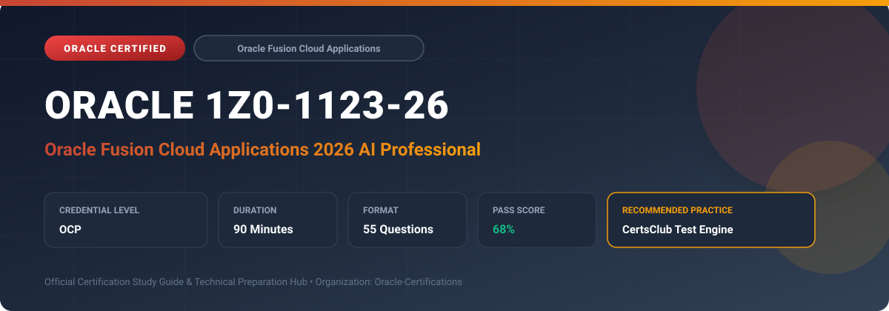

  

# Oracle 1Z0-1123-26: Oracle Fusion Cloud Applications 2026 AI Professional

---

## 1. Exam Overview & Candidate Profile

The **Oracle 1Z0-1123-26: Oracle Fusion Cloud Applications 2026 AI Professional** certification validates expertise in configuring, managing, and leveraging embedded and generative AI across Oracle Fusion Cloud Applications.

Candidates prove their ability to implement embedded AI solutions across Oracle ERP, HCM, SCM, and CX, configure generative AI copilots, manage data privacy, and monitor AI feature performance.

### Target Audience & Prerequisites
- **Target Roles**: Implementation Specialists, Cloud Architects, Technical Leads, Enterprise Consultants, and Systems Engineers.
- **Recommended Experience**: 1–2 years of practical, hands-on experience designing, implementing, and maintaining corresponding Oracle solutions.
- **Credential Earned**: OCP Certification.

---

## 2. Key Exam Specifications

| Specification | Details |
| :--- | :--- |
| **Exam Code** | **Oracle 1Z0-1123-26** |
| **Official Title** | Oracle Fusion Cloud Applications 2026 AI Professional |
| **Certification Track** | Oracle Fusion Cloud Applications |
| **Exam Duration** | 90 Minutes |
| **Number of Questions** | 55 Questions |
| **Passing Score** | 68% |
| **Question Format** | Multiple Choice (Single/Multiple Answer), Scenario-Based Questions |
| **Delivery Provider** | Oracle University / Pearson VUE (Online Proctored or Test Center) |
| **Recommended Practice Engine** | [CertsClub Oracle Practice Tests](https://www.certsclub.com/oracle/1z0-1123-26-dumps.html) |

---

## 3. Official Blueprint & Exam Domain Breakdown

The examination assesses candidate competencies across core functional domains weighted as follows:

| Domain Area | Weighting |
| :--- | :--- |
| **Oracle Fusion AI Architecture & Trust Framework** | `25%` |
| **Embedded AI & Generative AI in ERP & EPM** | `25%` |
| **AI Capabilities in Oracle HCM Cloud (Candidate Matching, Journeys)** | `20%` |
| **AI in SCM & Customer Experience (CX)** | `15%` |
| **AI Security, Data Governance & Prompt Customization** | `15%` |

---

## 4. Deep Dive into Complex & Challenging Technical Topics

To secure a passing score on the 1Z0-1123-26 exam, candidates must master the following advanced concepts:

- Oracle's Generative AI architecture in Fusion: Dedicated GPU clusters, tenant isolation, and zero customer data retention.
- AI in Financials: intelligent account combination default, supplier invoice automated entry, and narrative reporting summaries.
- AI in HCM: automated job description generation, employee performance summary generation, and skills ontology matching.
- AI in SCM: demand sensing, inventory anomaly detection, and automated delivery note processing.
- Managing Fusion AI administrator toggles, audit logs, and prompt tailoring.

---

## 5. Scenario-Based Demo & Practice Questions

### Question 1
How does Oracle Fusion Cloud ensure customer data privacy when users interact with embedded Generative AI capabilities (such as generating job descriptions or executive summaries)?

A) Customer data is not shared with third-party LLM providers, and prompts are never used to train base models
B) Data is publicly published to open-source models
C) Prompts are saved in public repositories
D) AI features run only on client local browsers

- **Correct Answer**: `A) Customer data is not shared with third-party LLM providers, and prompts are never used to train base models`  
- **Technical Explanation**: Oracle's enterprise AI architecture isolates customer prompts and outputs, ensuring data is never commingled, shared with third parties, or used to retrain foundational models.

---

### Question 2
Which embedded AI feature in Oracle ERP Cloud automatically extracts invoice header and line-item details from emailed PDF supplier invoices to generate draft payables records?

A) Intelligent Document Recognition (IDR)
B) General Ledger Allocation Rule
C) Sourcing Optimization Engine
D) Fixed Asset Retirement Engine

- **Correct Answer**: `A) Intelligent Document Recognition (IDR)`  
- **Technical Explanation**: Intelligent Document Recognition (IDR) in Oracle Cloud Payables uses advanced machine learning and OCR to automatically capture invoice data from incoming supplier documents.

---

## 6. Recommended Preparation Strategy & Practice Testing Engine

Achieving certification in **Oracle 1Z0-1123-26** requires balanced theoretical study and scenario-based simulation practice:

1. **Review Oracle Documentation**: Master architecture guides, implementation workbooks, and administration manuals on the Oracle Help Center.
2. **Hands-on Lab Practice**: Execute real-world configuration, policy setup, and troubleshooting tasks in your cloud tenancy or test instance.
3. **Simulated Exam Drills**: Practice answering timed, scenario-based multiple-choice questions to familiarize yourself with the question formats, traps, and timing constraints.

### Practice With CertsClub
For realistic practice questions, updated dumps, and mock testing environments:
- **Resource**: [CertsClub Oracle Practice Test Engine](https://www.certsclub.com/oracle/1z0-1123-26-dumps.html)
- **Special Discount**: Use coupon code **`club20`** during checkout for an instant **20% discount** on all practice exam bundles and testing engines.

---

## 7. Official Documentation & References

- [Oracle University Certification Registry](https://education.oracle.com/)
- [Oracle Help Center Documentation Portal](https://docs.oracle.com/)
- [Oracle Cloud Infrastructure & Applications Guides](https://docs.oracle.com/en/cloud/)
- [CertsClub Oracle Certification Exam Practice](https://www.certsclub.com/oracle/1z0-1123-26-dumps.html)

---

## 8. SEO & Discovery Keywords

`oracle 1z0-1123-26, oracle 1z0-1123-26 exam, oracle 1z0-1123-26 dumps, 1Z0-1123-26 practice questions, 1Z0-1123-26 study guide, oracle fusion cloud applications 2026 ai professional, certsclub 1z0-1123-26`